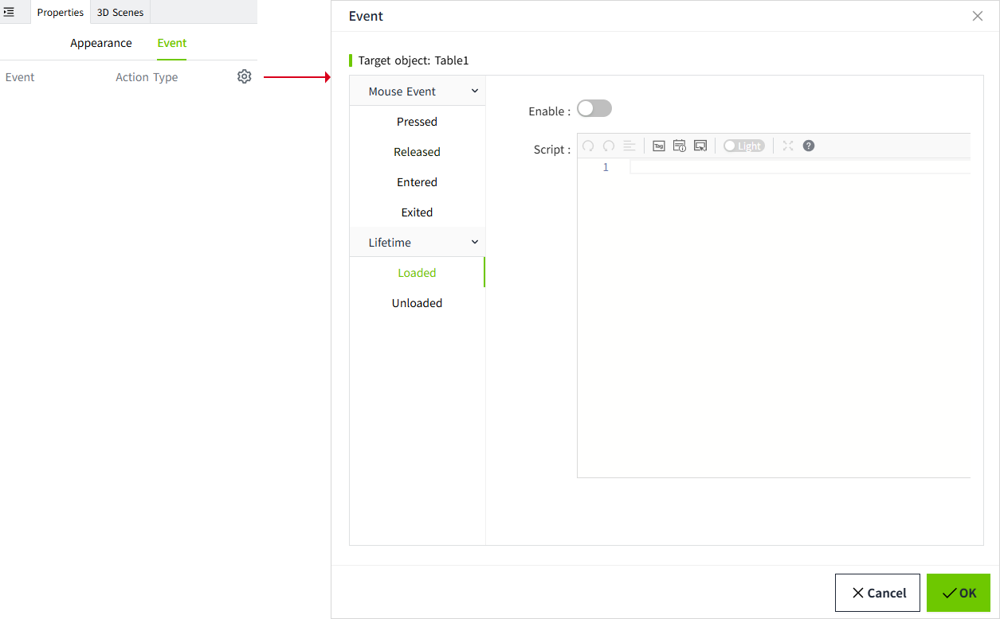

# Event

Trigger other operations or programs in the system in response to a specific event. 

In VC Hub, configure specific events in the "Event" column of the page or control.

## **How to trigger an event**

Specific events can be triggered by the following events.

#### Mouse Event

All controls support mouse events.

Mouse events refer to triggering specific events when the user uses the mouse to operate the page or controls. Include:

- Pressed
- Released
- Entered
- Exited

#### Property Change

When the value of the control's properties (currently only the value property is supported) changes, a specific event is triggered.

Property change events are supported only for the following controls:

- Dropdown
- Text Input
- Slider
- Datetime Input
- Number Input
- Label
- Value Display
- LED Display
- Checkbox
- Radio Button

#### Lifetime

All controls support lifetime events.

When a page or control is loaded or destroyed, a specific event is triggered.

## WAGO Protocol Commands

Select **Command** under an event's **Action Type** to execute a command on an enabled WAGO Protocol device. You can configure initial execution parameter values and bind response parameters to writable tags. At runtime, the event opens a window where the user checks the parameters and clicks **Execute**.

For the complete configuration and runtime procedure, see [WAGO Protocol Command Execution](../../management-platform/devices/wago-protocol/command-execution.md 'WAGO Protocol Command Execution').

