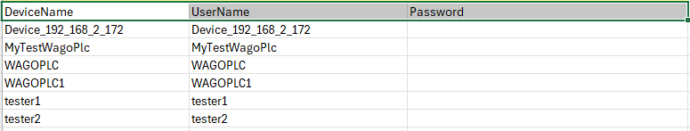
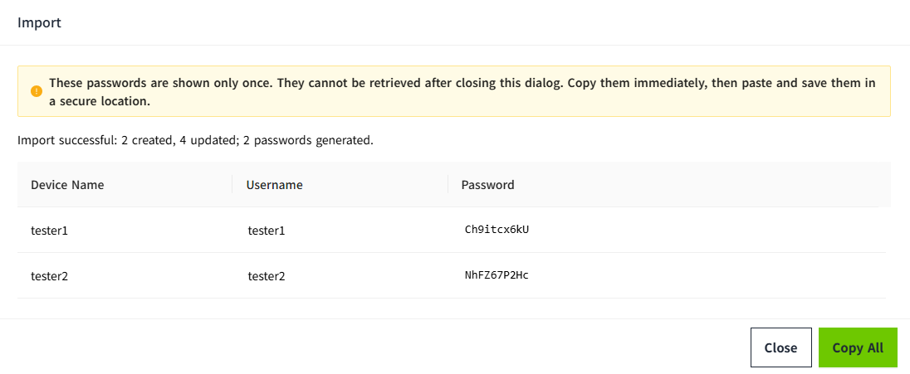
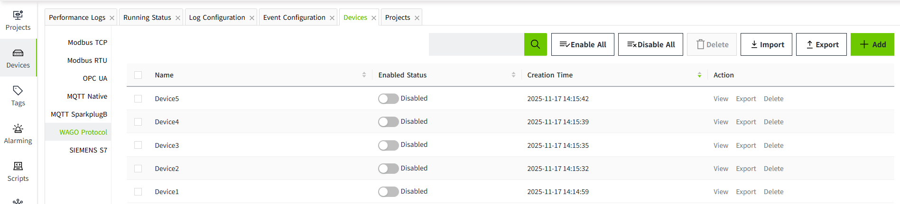
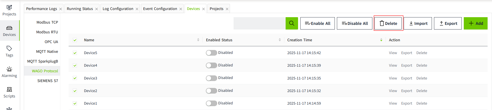

# Batch Operation of WAGO Protocol Devices

Use Excel export and import to add or update multiple WAGO Protocol devices. To obtain a template, first add a demonstration device and export it.

## Exporting Devices

Click **Export** above the device list to export all devices, or click **Export** in a device's row to export that device. The exported `.xlsx` file contains an instructions row followed by these columns:

| Column | Exported value | Use during import |
|---|---|---|
| `DeviceName` | Device name. | Required. Determines whether a device is added or updated. |
| `UserName` | Connection username generated from the device name. | Accepted for reference. Changes to this column are ignored. |
| `Password` | Always empty. | Optional. Enter a password to set or replace it, or leave it empty to apply the rules below. |

Passwords are not included in exports and cannot be recovered by exporting a device.

## Preparing the Import File

1. Open the exported file in Excel. Keep the column headers and add or edit the device rows beneath them.
2. Enter a unique `DeviceName` for each row. Names must follow the device naming rules and be no longer than 100 characters.
3. To supply a password, format the **Password** cells as **Text** before entering values. Passwords must contain 8–64 printable ASCII characters without spaces. Numeric cells and formula cells are rejected; an all-digit password must still be stored as text.
4. Save the file as `.xlsx`.

Each `DeviceName` may appear only once in the file. Duplicate names, invalid passwords, or invalid rows cause the import to fail. Password and row validation messages identify the relevant Excel rows. Remove unused device rows rather than leaving rows with empty names.

Both the exported layout with its leading instructions row and the older layout with headers in the first row are accepted. Older templates may omit `UserName` or `Password`. A missing Password column has the same effect as an empty password cell.

### Password Rules

| Device in the import file | Password cell | Result |
|---|---|---|
| New device | Filled in | Create the device with the supplied password. |
| New device | Empty | Generate a random 10-character password and display it after import. |
| Existing device with the same name | Filled in | Replace the existing password with the supplied password. |
| Existing device with the same name | Empty | Keep the existing password. |

The username is generated by VC Hub. Filling in `UserName` does not create a custom connection username.

## Importing Devices

1. Click **Import** above the device list and select the `.xlsx` file.
2. If passwords were generated for new devices, a credentials window displays the device names, usernames, and passwords, together with the number of devices created and updated.
3. Click **Copy All**, then paste and save the credentials before closing the window. These generated passwords are displayed only once.
4. Enable the devices that you want to use and configure their PLC connections with the saved or supplied credentials.

The credentials window contains only new devices whose passwords were generated automatically. It does not include existing devices or new devices with supplied passwords. If no passwords were generated, the system displays an import success message.

**All devices added or updated by import are disabled afterward.** Updating an existing device also disconnects its current PLC session. Re-enable it after import; if its password changed, update the PLC connection settings before reconnecting. Devices not included in the file are unaffected.

## Batch Modification

Export the devices, edit the required rows, and re-import the file. Devices are matched by **DeviceName**:

- A matching name updates the existing device according to the password rules above and disables it.
- A name that does not exist creates a new disabled device. Changing a name in Excel therefore creates another device; it does not rename the original device.
- Devices whose names are absent from the file remain unchanged.

To retain existing passwords, leave the Password cells empty. To replace selected passwords, fill in only those cells.

## Batch Deletion

Disable the devices to be deleted, select them on the current page, and click **Delete** above the list.

Enabled devices cannot be selected for deletion. Batch selection is limited to the current page; repeat the operation on other pages if needed.
