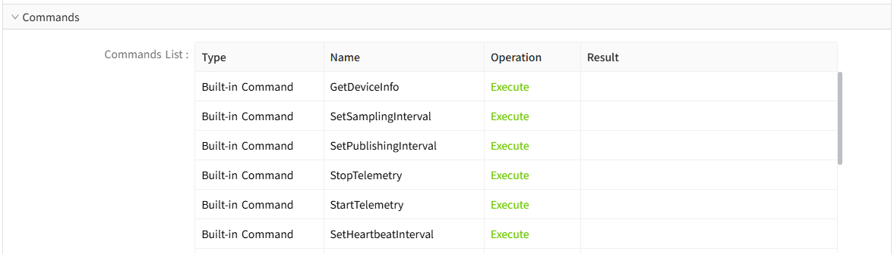
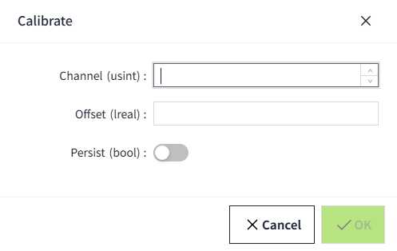
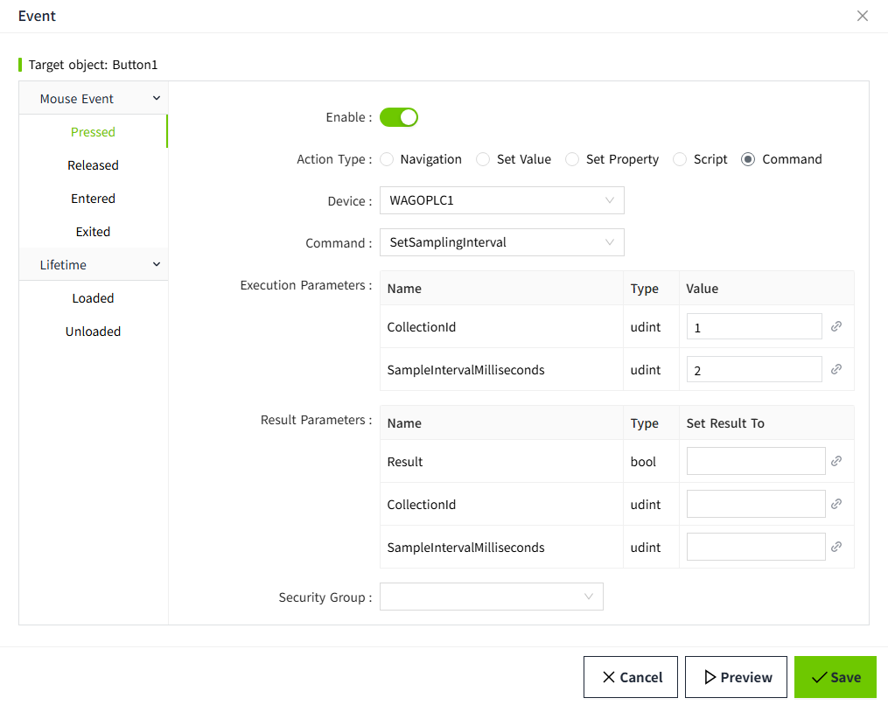
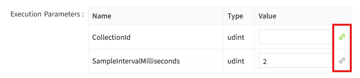
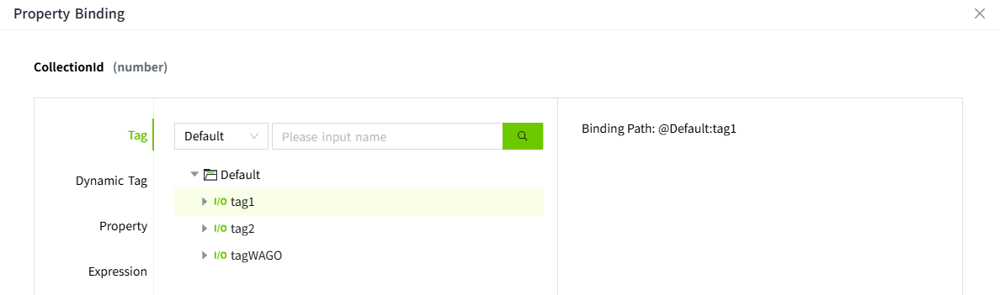
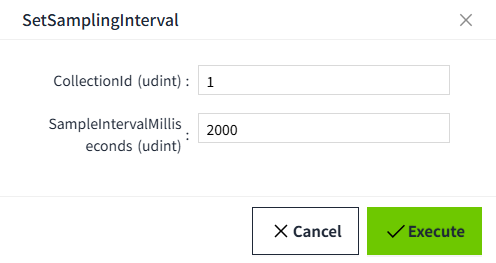
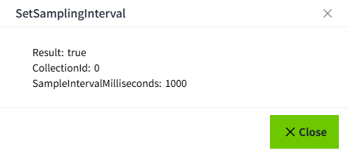
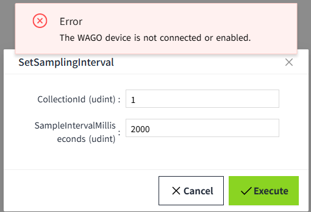

# WAGO Protocol Command Execution

Use the selected device's command list to execute commands from either the device details or a configured page control event. Command availability depends on the protocol version, the PLC's reported capabilities, and the custom commands registered by its application.

Before executing a command, enable the device, connect the PLC, and allow its protocol session to be established. You also need permission to execute the operation. See [WAGO Protocol](index.md) for connection setup.

## Viewing the Device's Commands

Open **Devices → WAGO Protocol → View** and expand **Commands**. The list contains:

- **Built-in Command:** A standard command definition provided by the WAGO Protocol driver. Its availability depends on the protocol version and the PLC's reported capabilities.
- **Custom Command:** A command registered by the PLC, including its name, request parameters, and response parameters. The number of commands and their definitions depend on the PLC application.

Use the commands available for the selected device. The screenshots show examples; another PLC application may register different commands or parameters.

For versions after `1.0`, the PLC must report support for standard commands before built-in commands become available. If **Execute** is disabled, hover over the action to read the reason. Reopen the device details after the PLC sends updated command registration to load its current custom commands.

### Command Parameters

VC Hub creates parameter inputs from the selected command's definition. Request parameters are the values sent to the PLC. Response parameters are the values returned by the PLC and can be bound to writable tags in a page event.

Parameter names and data types are shown in the execution window. For example, `usint` is an unsigned 8-bit integer, `udint` is an unsigned 32-bit integer, `lreal` is a floating-point number, and `bool` is a Boolean value.

For an interval command such as `SetSamplingInterval`, enter the PLC's **Collection Key** from the device details as `CollectionId`. The separate **Collection ID** shown there is a VC Hub record identifier. The collection must exist on the selected device. Execution of `SetSamplingInterval` is rejected for collections whose sampling is controlled only by the PLC application (`iec_only`).

VC Hub supplies `RequestId` automatically when executing a command. You do not enter or bind that request parameter in the interface.

For the PLC-side I/O tag back-write example, see [PLC Back-Write Reference](command.md). That reference describes the legacy three-parameter write response; custom commands executed through the interface use the general command response described there separately.

## Executing from Device Details

1. Open **View** for the device and find the command in **Commands**.
2. Click **Execute**. The window title is the command name.
3. Enter the request parameter values. Commands without request parameters display **This command has no parameters.**
4. Click **OK**. The button shows a loading state while VC Hub waits for the response.
5. When a command result is returned, the window closes and the **Result** column displays the response parameters or error. A validation or connection error can leave the window open so that you can correct the problem.

| Parameter type | Input |
|---|---|
| String | Text field. |
| Integer | Numeric field accepting whole numbers. |
| Floating-point number | Numeric field accepting decimal values. |
| Boolean | Toggle switch. |

Numeric values must be within the range of the registered data type. Results displayed in the device details belong to the current window; they are not a command history.

The following example shows a PLC-registered `Calibrate` command with integer, floating-point, and Boolean inputs. Your command's inputs follow its own definition.

## Configuring a Button Event

1. In the page designer, select a **Button** and open its **Event** configuration. Choose the mouse event that should open the command window, for example **Pressed**.
2. Enable the event and select **Command** under **Action Type**.
3. Select a **Device**. Only enabled WAGO Protocol devices are offered.
4. Select a **Command**. Only commands currently available for that device are offered.
5. Under **Execution Parameters**, optionally supply initial values. Enter static values or use the binding button to select tags, page or control properties, dynamic tags, or expressions.
6. Under **Result Parameters**, optionally select a writable tag for each response parameter. The target tag must match the response parameter's data type. This selector binds results to tags.
7. Click **Save** to save the event configuration, then save the page. If the operation requires a security group, configure it using [Event Security Group](../../../2d-visualization/event/security-group.md 'Event Security Group').

Execution parameter values are optional in the event configuration because the user can enter or change them in the runtime window. Parameter bindings are evaluated once when that window opens. They do not continuously update while the window remains open.

### Binding an Execution Parameter

Click the binding button beside a parameter's value to open **Property Binding**.

Choose **Tag**, **Dynamic Tag**, **Property**, or **Expression** as the value source. For a tag binding, select a tag with a matching data type and confirm the binding. The selector shows the selected tag and its **Binding Path** on the right.

A configured binding supplies the initial value when the runtime command window opens. For that parameter, the bound value takes precedence over a static value entered in the event configuration.

## Executing at Runtime

1. Open the configured page and trigger the button event.
2. The command window opens with the configured initial values. Check or edit them; fill in any remaining parameters.

    

3. Click **Execute**. If the event has a security group, complete the authorization when prompted. The command is sent after this confirmation.
4. While VC Hub waits for the response, the Execute button shows a loading state and the window cannot be closed.
5. The result is displayed in the same window. When a response is received without an error, configured result tags are updated from the returned parameters.
6. Click **Close**, or the close button in the upper-right corner, to dismiss the window.

The following example response shows the values returned by the PLC for a separate command execution.

## Understanding Results and Errors

A received response means that the PLC replied. Check returned values such as `Result`, `Success`, `Started`, or `Stopped` to determine the operation's outcome. The default wait for a general command response is 30 seconds.

| Message or situation | Action |
|---|---|
| Device is not connected or enabled | Enable the device and check the PLC's MQTT connection. |
| Protocol handshake has not completed | Wait for the session to be established; check the supported protocol version and device logs. |
| Device has not reported support for standard commands | Check the PLC's standard-command configuration and reported capabilities. |
| Command is no longer registered | Check the PLC registration, then select the current command again in the event configuration. |
| Parameters do not match the definition | Check the parameter values and data type ranges. |
| Collection does not allow cloud sampling control | Use the sampling controls provided by the PLC application for that collection. |
| No response before the timeout | Check the PLC and connection before deciding whether to retry. A timeout means that the execution outcome is unknown. |
| Device disconnected while waiting | Restore the connection and check whether the PLC performed the action. |
| Command could not be published | Check the connection and device logs, then retry when communication is restored. |

If the request is rejected before execution, an error message appears and the parameter window remains open. The following example shows a device that is not connected or enabled.

