# WAGO Protocol

The WAGO Protocol driver connects WAGO PLCs to the MQTT broker provided by VC Hub. Each device has its own connection credentials. After connecting, the PLC supplies device information, collections, tags, and custom command definitions.

VC Hub supports the following WAGO Protocol versions:

| Versions | Payload format |
|---|---|
| `1.0`, `1.2`, `1.4.0`, `1.5.0` | Uncompressed JSON |
| `1.4.1`, `1.5.1` | GZIP-compressed JSON |

## Adding and Enabling a Device

1. Open **Devices → WAGO Protocol** and click **Add**.
2. Enter a device name that is unique in the device list.

    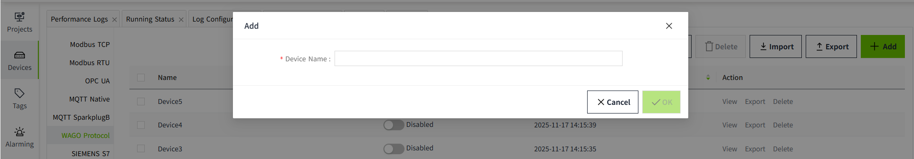

3. Click **OK**. The **Device Credentials** window displays the generated username and password. The password is a random 10-character string containing letters and numbers.
4. Save the credentials before closing the window. The password cannot be viewed again after the window is closed.

    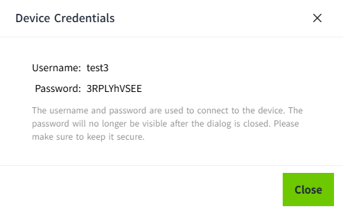

5. The new device is disabled by default. Enable it using the status switch in the device list before connecting the PLC.

    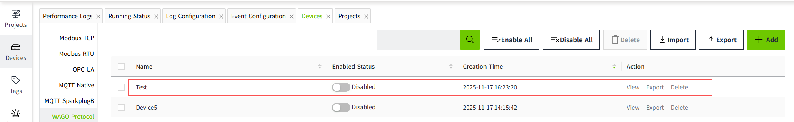

The status switch shows whether the driver is enabled. It does not show whether the PLC is connected. **Enable All** and **Disable All** apply to all devices in the list.

| Field | Description |
|---|---|
| Device Name | Unique name used to identify the device. |
| Username | Automatically generated connection username. Use the exact value displayed in the credentials window; it cannot be edited. |
| Password | Connection password displayed when the device is created. If it is lost, generate and save a new password in the device details. |

For multiple devices, see [Batch Operation](batch-operation.md).

## Connecting the PLC to the MQTT Broker

Use the credentials saved when the device was created. If the password is unavailable, follow [Resetting the Password](#resetting-the-password) before configuring the PLC.

1. Open the PLC's **WBM (Web-based Management)** in a browser and sign in with the PLC's WBM credentials.
2. Under **Configuration → Cloud Connectivity**, select **Connection 1**.
3. Configure the connection:

    | WBM field | Setting |
    |---|---|
    | Enabled | Enable the connection. |
    | Cloud platform | Select **MQTT AnyCloud**. |
    | Hostname | Enter the address of the VC Hub MQTT broker reachable from the PLC. |
    | Port number | Use the broker's configured TCP port. The example below uses `1884`. The enabled TCP port is also shown in the VC Hub device details. |
    | Client ID | Use the device name entered in the WAGO Protocol device list. |
    | Clean session | Enable this option. |
    | User | Enter the username from the VC Hub credentials window. |
    | Password | Enter the saved device password. |
    | Data protocol | Select a supported WAGO Protocol version available on the PLC, for example **WAGO Protocol 1.5**. |
    | Use compression | Uncompressed communication is supported. Compression is also supported when the negotiated version is `1.4.1` or `1.5.1`. |

4. Click **Submit** and restart the PLC if WBM indicates that a restart is required.
5. Check the connection under **Cloud Connectivity → Status**. Once the PLC is connected and its protocol session is established, VC Hub can receive its information and tag data.

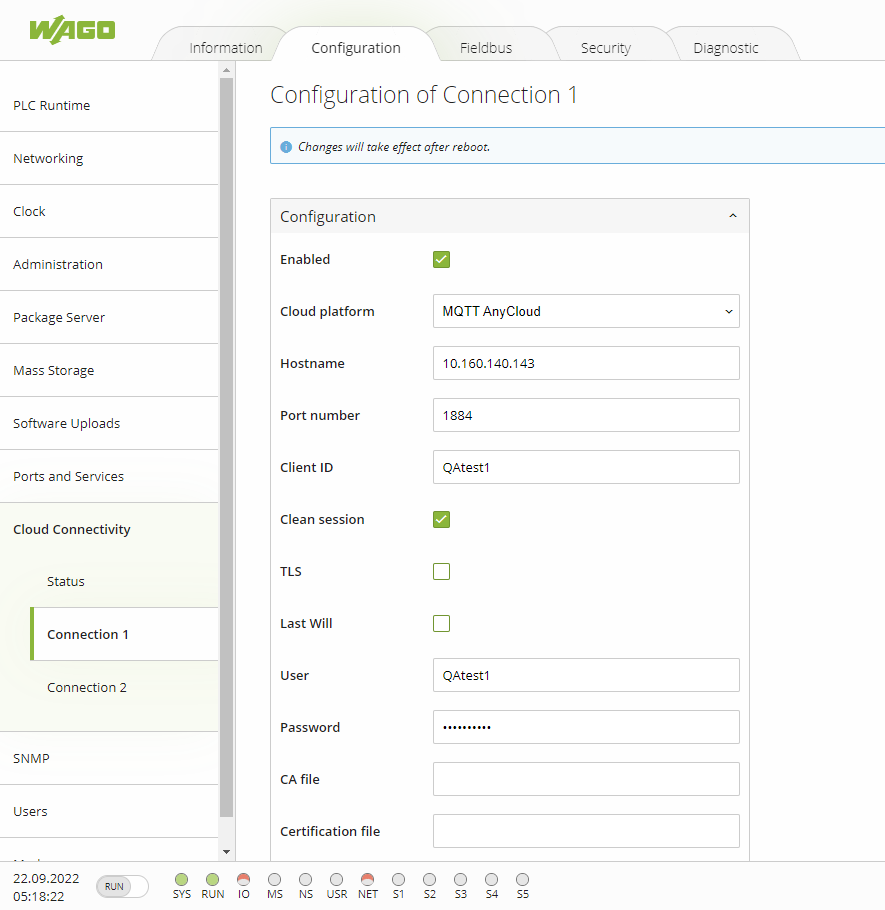

### Protocol Handshake

For versions after `1.0`, the PLC sends **DeviceHello** and VC Hub replies with **CloudHello** to select a supported protocol version. This happens automatically; there is no separate handshake switch in the Add Device window. VC Hub prefers a supported uncompressed version when the PLC offers both compressed and uncompressed versions.

Version `1.0` uses the legacy connection flow without this handshake. VC Hub identifies that version from the PLC's messages.

Commands require an enabled, connected device with an established protocol session. If the session is not established, check the PLC's connection settings and the device logs for an unsupported version or incomplete handshake.

## Enabling TLS

To connect over TLS, enable the MQTT broker's TLS listener and configure the PLC connection as follows:

- **Port number:** Use the broker's configured TLS port. The example below uses `3883`; the enabled TLS port is also shown in the VC Hub device details.
- **TLS:** Enable this option.
- **CA file:** Copy the certificate needed to trust the broker to the PLC and enter its path, for example `/etc/ssl/certs/server-cert.pem`.
- **User / Password:** Use the same device credentials as for the TCP connection.

Apply the settings and restart the PLC if required by WBM.

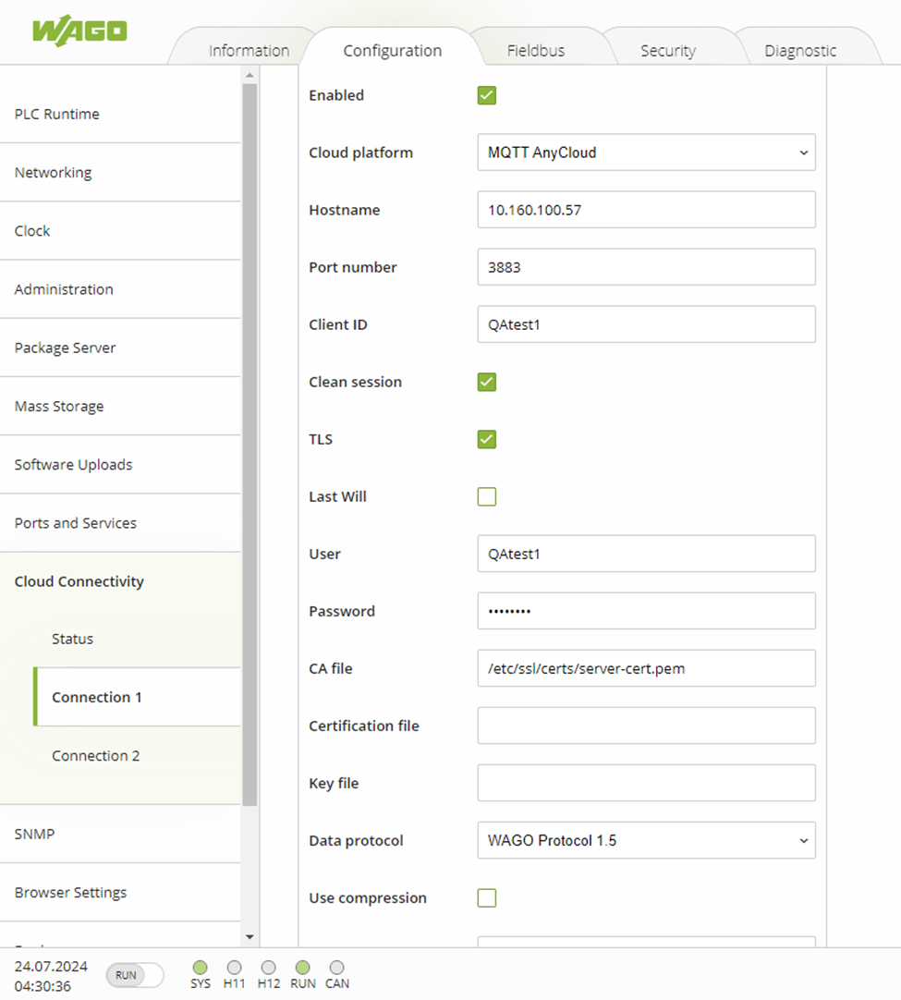

## Viewing Device Details

Click **View** for a device in the list. The window contains **Basic**, **Commands**, and **Collection** sections.

### Basic

| Field | Description |
|---|---|
| Device Name / Username | Read-only device name and connection username. |
| Password | Use **Reset** to generate a new password. The existing password is not displayed. |
| TCP Port / TLS Port | Broker ports, shown when the corresponding listener is enabled. |
| Protocol Version | Most recently recorded protocol version used by the device. |
| NTP | Time synchronization setting reported by the PLC, such as a server address or `disabled`. |

Protocol Version and NTP may be empty until the relevant information is received. Recorded device information does not by itself indicate that the PLC is currently connected.

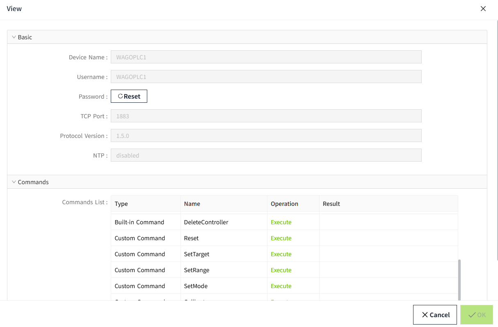

### Resetting the Password

1. Click **View** for the device, then click **Reset** in **Basic**.
2. Save the generated password displayed next to the button.
3. Click **OK** and confirm the password change. The new password becomes active, the old password stops working, and the current PLC connection is disconnected.
4. Update the password in the PLC's MQTT connection settings and reconnect.

Clicking **Reset** only generates a candidate password. If you cancel without saving, the existing password remains active. The new password cannot be viewed again after the window is closed.

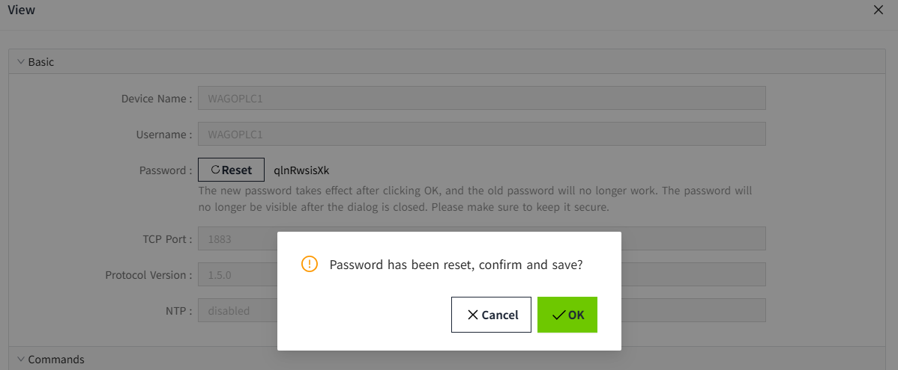

### Commands

The **Commands** section displays each command's type, name, execution action, and result. VC Hub provides built-in command definitions according to the protocol version and checks the PLC's reported capabilities. Custom commands and their parameters come from the PLC's registration. The number of custom commands and their names vary by PLC application. Use the commands available for the selected device; see [Command Execution](command-execution.md) for the execution steps.

### Collections and Tags

The **Collection** section displays collections as tree nodes, with their tags underneath. You can expand or collapse a collection. No node is selected when the window first opens.

- Select a collection to display **Collection ID**, **Collection Key**, **Sample Rate (ms)**, and **Publish Interval (ms)** on the right.
- Select a tag to display **Data Type**, **Unit**, and **Type ID** on the right.

**Collection ID** identifies the collection record in VC Hub. **Collection Key** is the PLC's protocol collection identifier. Use **Collection Key** when supplying the `CollectionId` parameter of a built-in command.

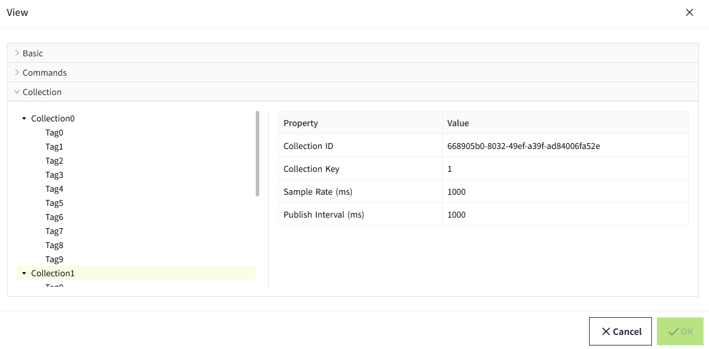

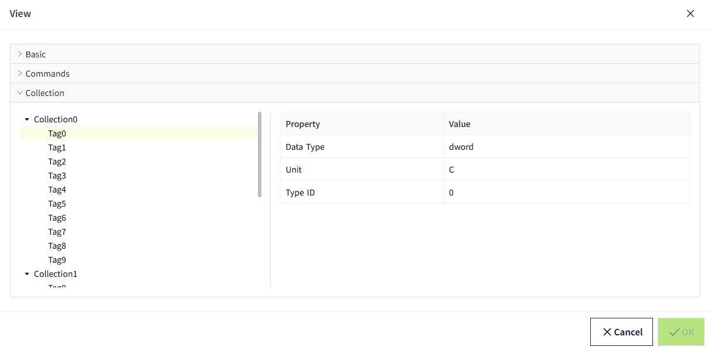

## Binding an I/O Tag

1. Create an **I/O Tag** with a data type that matches the PLC tag.

    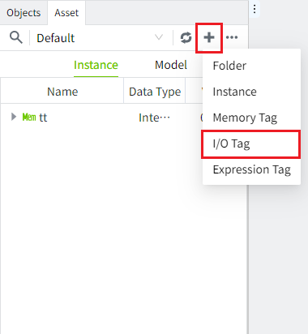

2. Click the binding button beside **Data Source**.

    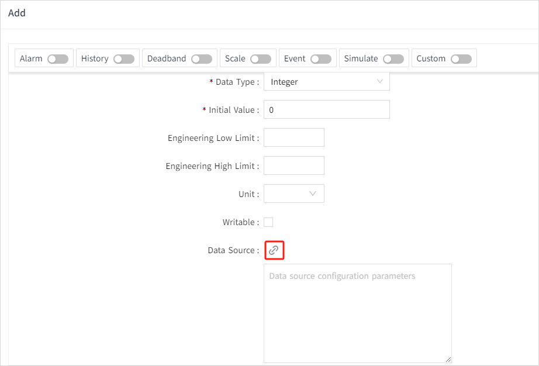

3. Expand **WAGO Protocol**, then expand the required device and select a collection.
4. Select a tag from that collection in the list on the right. Use **Search by Name** to filter the list. **Show Matched Type Only** is enabled by default; tags with incompatible data types cannot be selected.
5. Click **OK** to save the data source binding, then save the I/O Tag.

    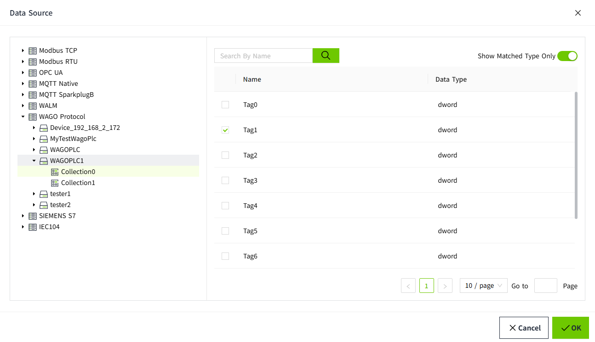

The binding includes the device, collection, and tag name. If tags in different collections share a name, select the correct collection before choosing the tag.

To write through a bound I/O Tag, mark it as writable and provide the corresponding PLC-side write command. See [PLC Back-Write Reference](command.md).

## Protocol Reference

For PLC-side protocol details and WagoAppCloud examples, refer to the [official WAGO Cloud Connectivity documentation](https://www.wago.com/global/d/15719) and [WAGO Download Center](https://downloadcenter.wago.com/).
