# Notifications

## 1. Message Notifications in MEMS

Message notifications indicate normal system events, successful operations, or automatic regulation activities, generally divided into three categories based on severity and display color:

| Color | Severity | Meaning | Typical Operator Action |
| :--- | :--- | :--- | :--- |
| Yellow | Warning | A potential issue or abnormal condition that requires attention. | Monitor the condition and take preventive action if necessary. |
| Red | Error / Critical | A fault, failure, or critical condition that may affect system operation. | Immediate action is required. Follow the alarm handling procedure. |
| Black | Info | A normal event, status change, or successful operation. | No immediate action is required. Review if necessary. |

The following action will trigger info message on black icon:

1. VC Hub is successfully connected

2. Sync is started or completed

3. System trigger Peakload regulation

4. System trigger Avoid Peakload regulation

5. System trigger Reactivation regulation

6. System stop Reactivation regulation

The following action will trigger Error / Critical message on red icon:

1. VC Hub is disconnected

2. License expired

The following action will trigger Warning message on yellow icon:

1. Sync failed

2. No License is available

3. License almost expired

4. Surplus regulation failed

The count of unread messages is displayed at the top of the icon. Click the icon, and detailed messages will be shown in the list.

Click the 'Mark all read' button, and the system will automatically mark all unread messages as read; the number of unread messages will decrease to 0.

Click the 'Clear all' button, and the system will automatically delete all messages in the list.

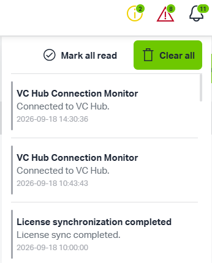

Error / Critical messages cannot be removed from the notification list until the user has explicitly acknowledged them. This prevents critical events from being missed, ignored, or deleted without review.

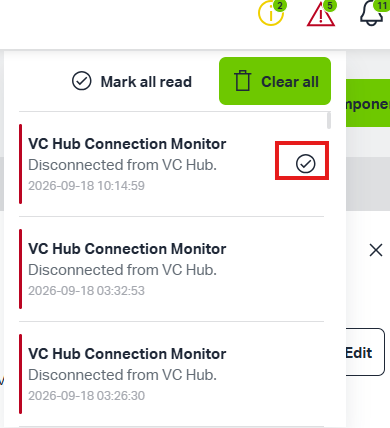

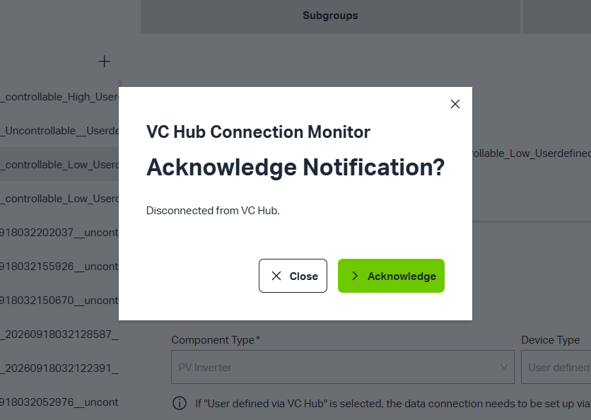

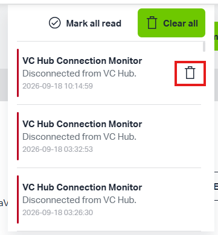

When all Error / Critical or Warning messages are cleared, the relevant icon will disappear.

### 2. Alerting Notifications from Grafana

#### 2.1 Notification configuration

Open Grafana website of MEMS enviornment

Click 'Alerting' sidebar button

Click Notification configuration> Contact points

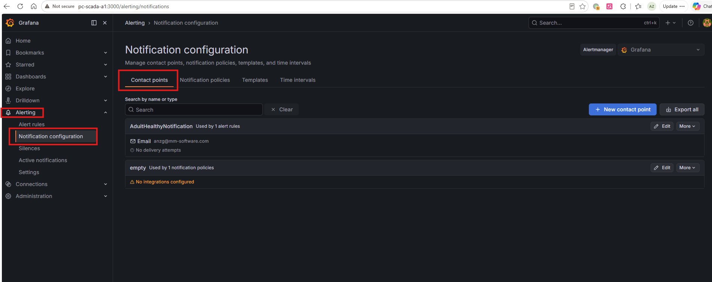

Click 'Add contact point' to add new notification email address

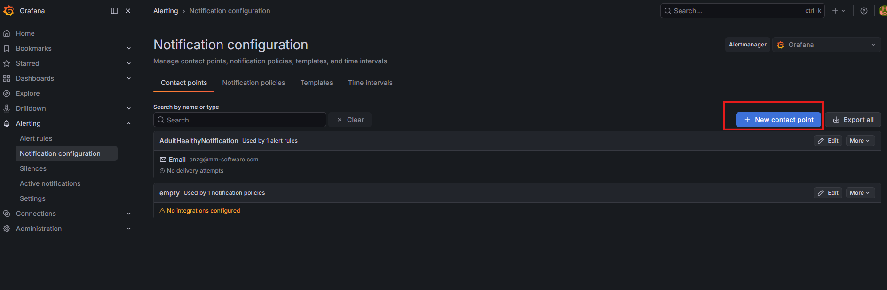

Fill in Name; Select Email integration; Fill in Email address; Click 'Save contact point' 

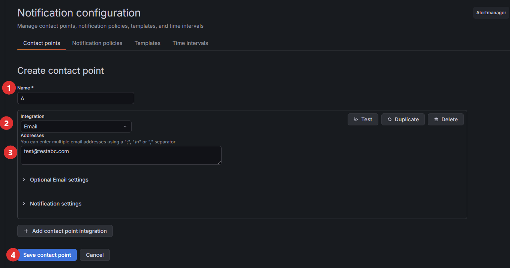

The page will turn to 'Contact points' tab, configurated Contact point will display nad marked as 'Unused'

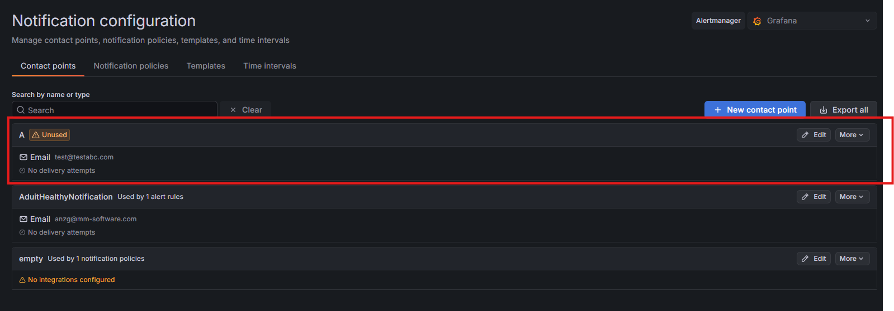

Click 'Edit' button, user can modify Notification configuration 

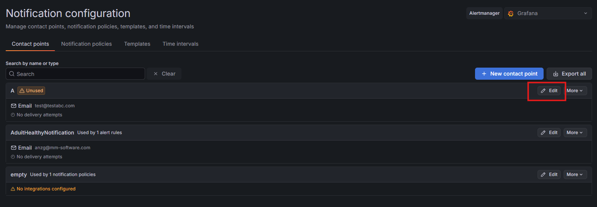

Click 'Test' button, system will send email to test verify the configurated address can receive message from Grafana

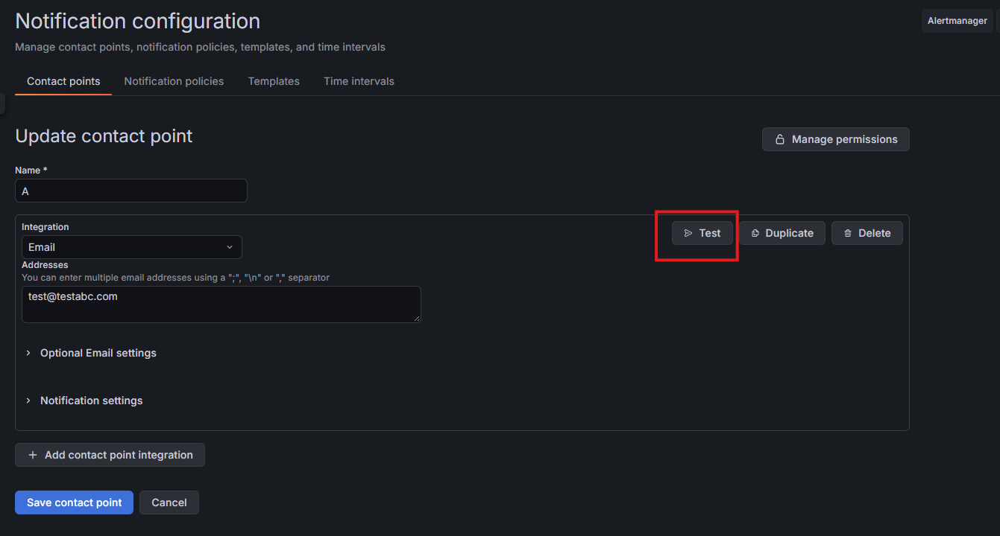

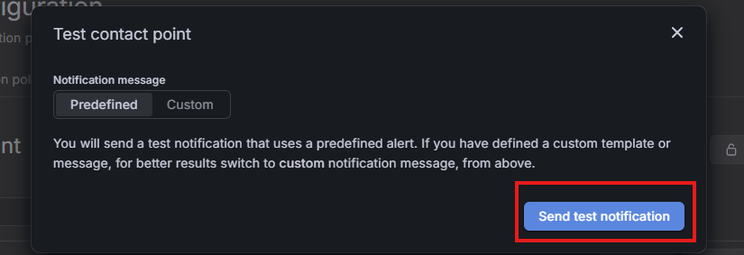

Open website of receiving notifications, user can see the specific message of Alerting Notifications from Grafana

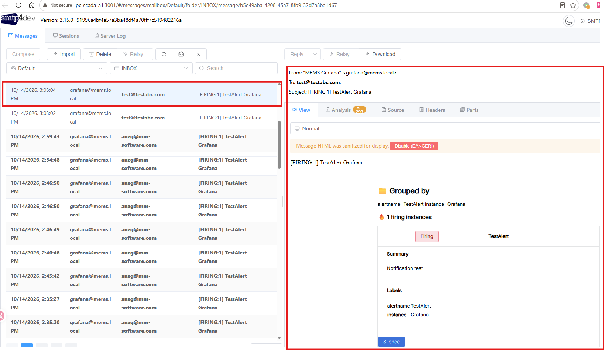

#### 2.2 Alert rules

Click Notification configuration > Contact points > Audit Log Pipeline Health button

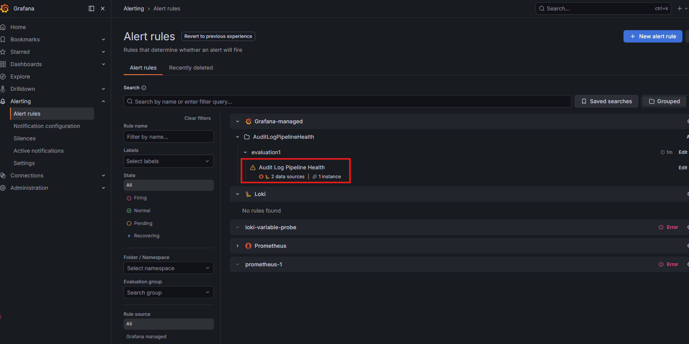

When unable Third-party audit log while MEMS system is running, status of Audit Log Pipeline Health will turn to 'Firing' and be red

