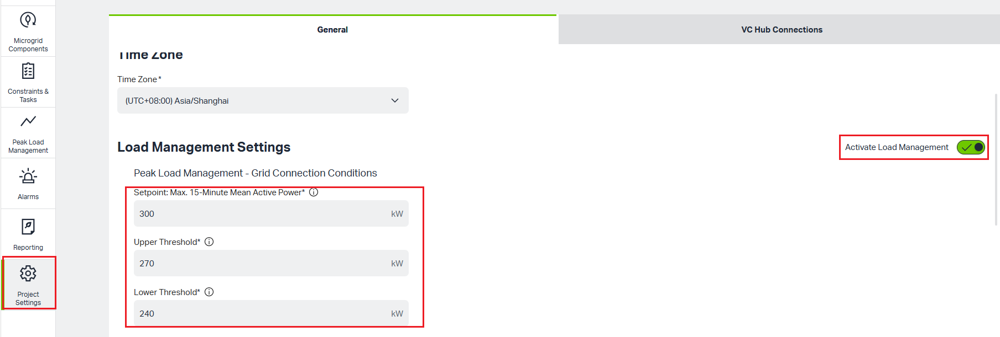
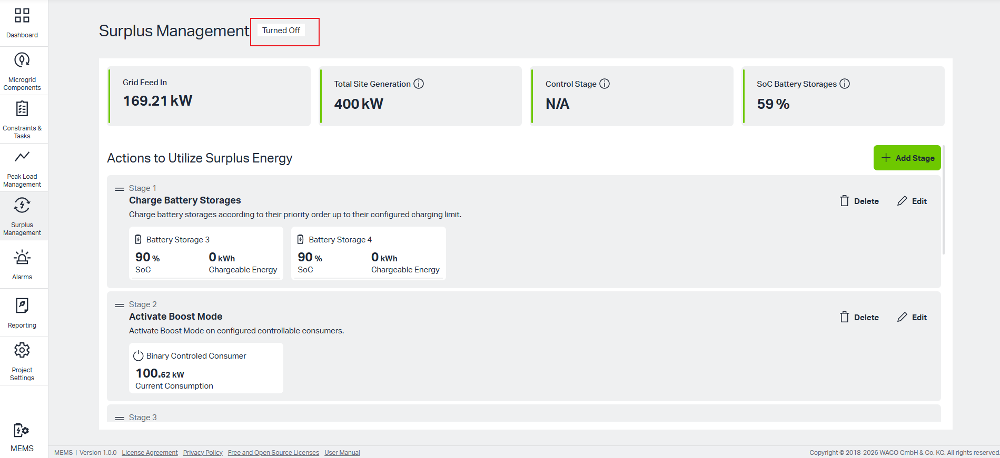
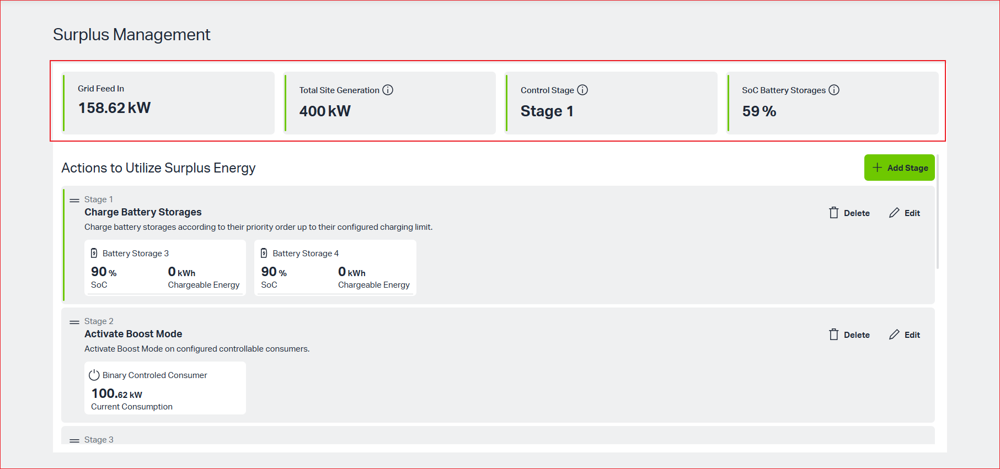
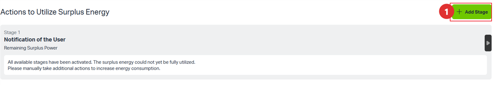
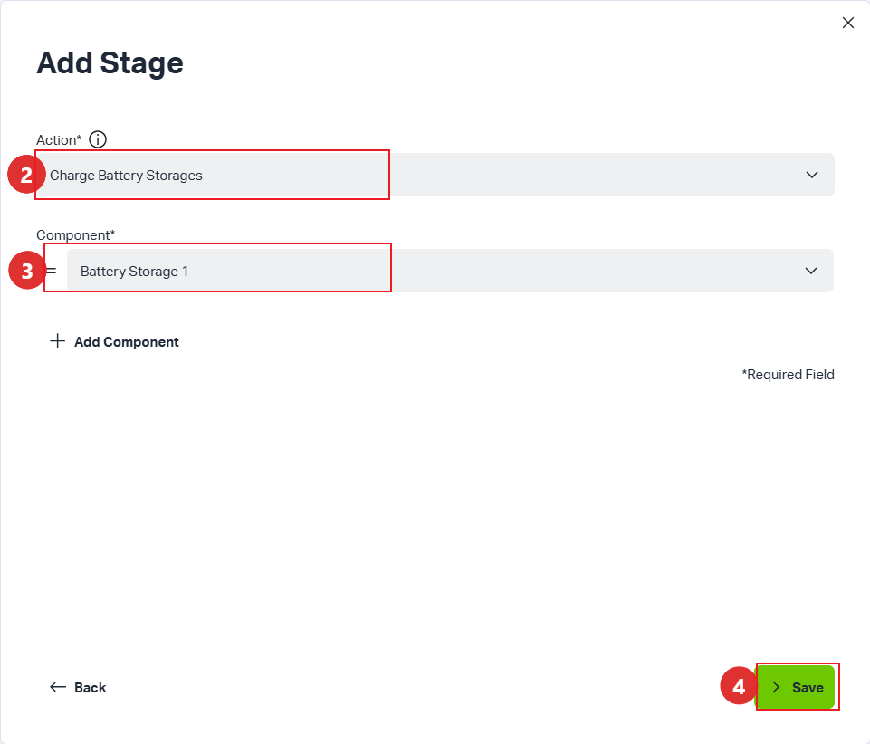
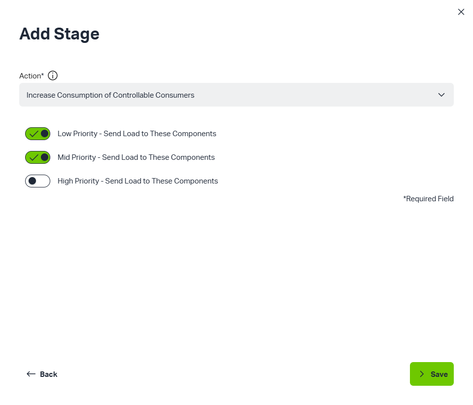
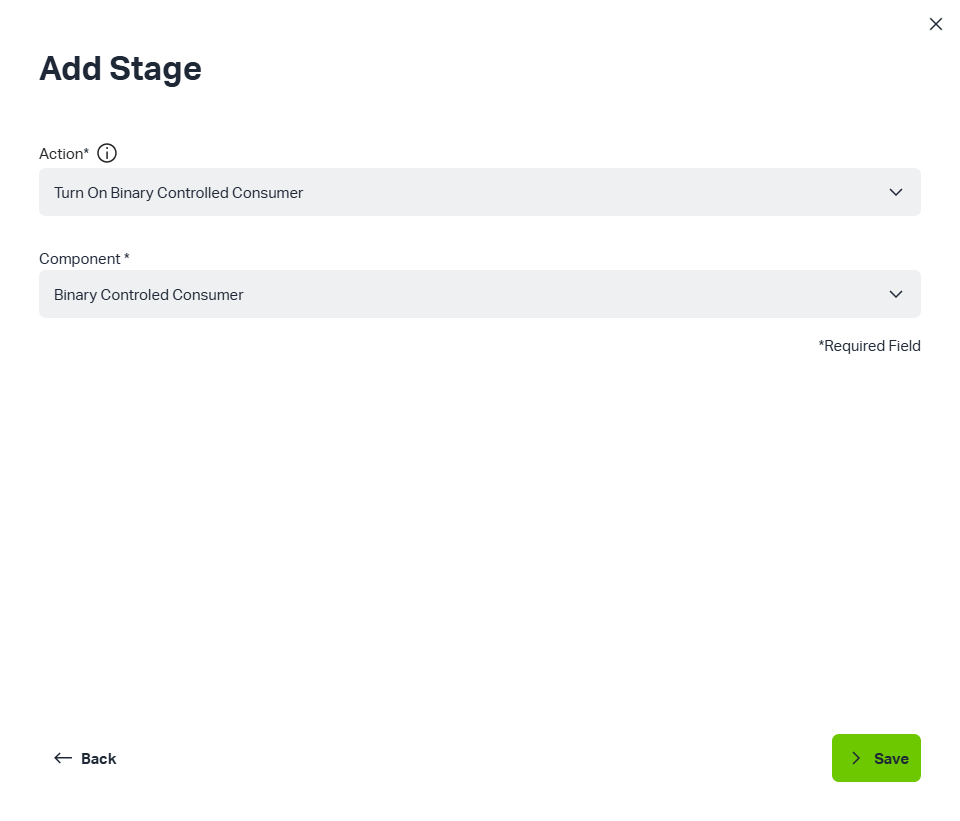
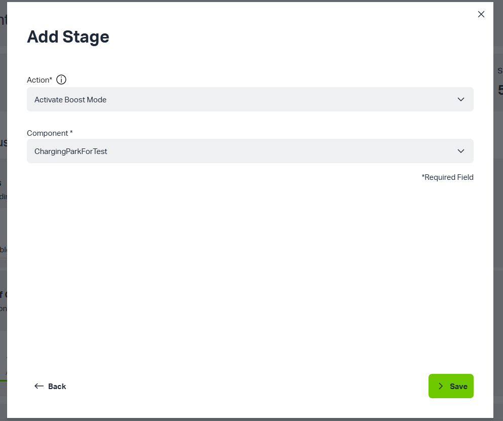
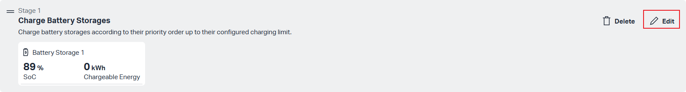
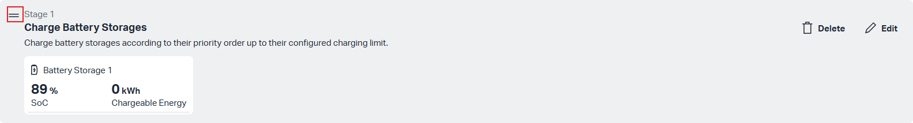

# Surplus Management
## 1. Introduction
The "Surplus Management" page is used to monitor and manage the surplus energy generated within the microgrid. Through predefined control stages, the system automatically allocates or consumes excess power to maintain system stability and efficiency.
Peak Load Management is activated if "Activate Load Managent" toggle is activated in the "Project Settings" based on entered "Setpoints", "Upper Threshold" and "Lower Threshold".

Users inactivate "Activete Load Managent" toggle, "Turn off" symbol displays to present the "Peak Load Management" feature of the system is currently inactivated.

## 2. Key Data Dashboard 

The top of the page displays four key real-time metrics of the microgrid's current operation:

**Grid Feed In**: The current power being fed into the grid.

**Total Site Generation**: The total power generation of the site.

**Control Stage**: The control strategy stage currently being executed by the system.

**SoC Battery Storages**: The average/overall State of Charge (SoC) of all connected battery storage systems.

(Note: For cards with the ⓘ icon, hover over the icon to view detailed information or calculation logic.)

## 3. Actions to Utilize Surplus Energy
This area is the core management interface, allowing users to define the processing logic for surplus energy by creating and prioritizing "Stages". The system executes these actions sequentially (Stage 1 -> Stage 2 -> ...).

Stage configuration
•Add a new Stage 1 - Charge Battery Storages

1. Click the green + Add Stage button

2. Select "Charge Battery Storages" for "Action" field

3. Select target battery storage for "Component" field

4. Click "Save" button, and Stage 1 is created successfully.

•Add a new Stage 2 - Increase Consumption of Controllable Consumers

1. Click the green + Add Stage button

2. Turn on the toggles that users want.

3. Click "Save" button and Stage 3 is created successfully.

•Add a new Stage 3 - Turn On Binary Controlled Consumer

1. Click the green + Add Stage button

Select "Turn On Binary Controlled Consumer" for "Action" field

3. Select target component for "Component" field

4. Click "Save" button, and Stage 3 is created successfully.

•Add a new Stage 4 - Turn On Binary Controlled Consumer

1. Click the green + Add Stage button

Select "Activate Boost Mode" for "Action" field

3. Select target component for "Component" field

4. Click "Save" button, and Stage 4 is created successfully.

## 4.Operational Recommendations:

•Edit a Stage

If users need to modify charging limits or load trigger conditions, click the Edit button of the corresponding stage to make adjustments.

• Dragging a stage
Users can adjust the execution priority of the stages by dragging the = icon on the left side of each stage (as shown in the image).

