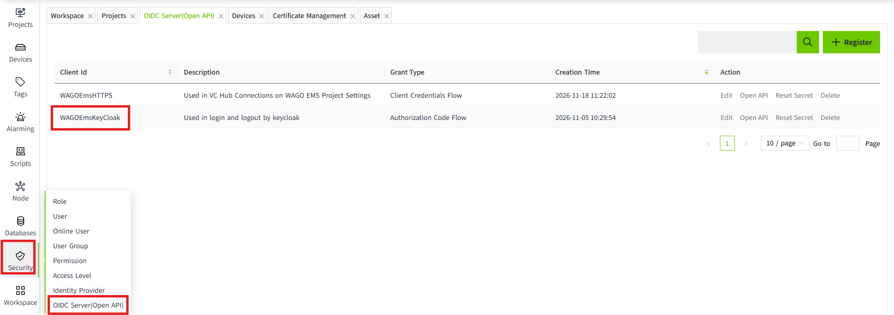
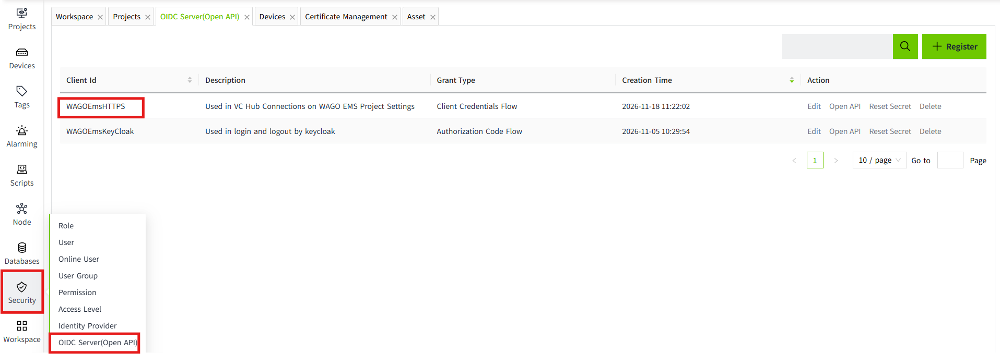
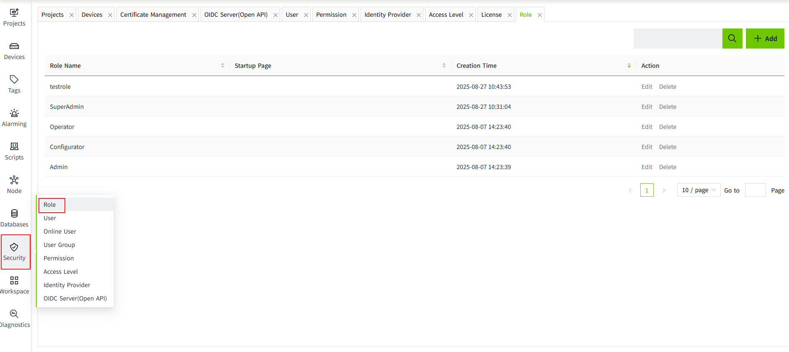
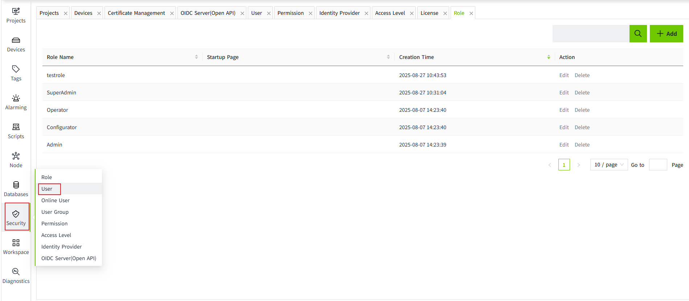
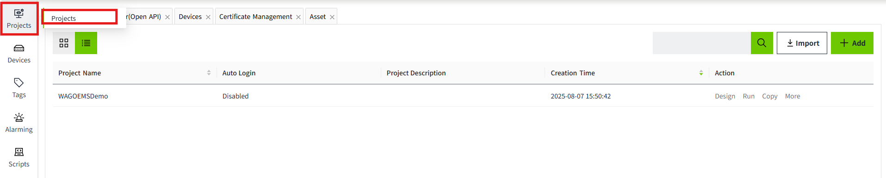
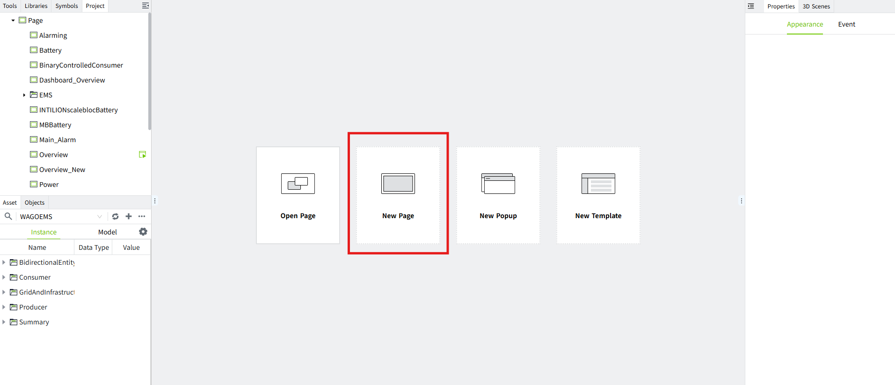
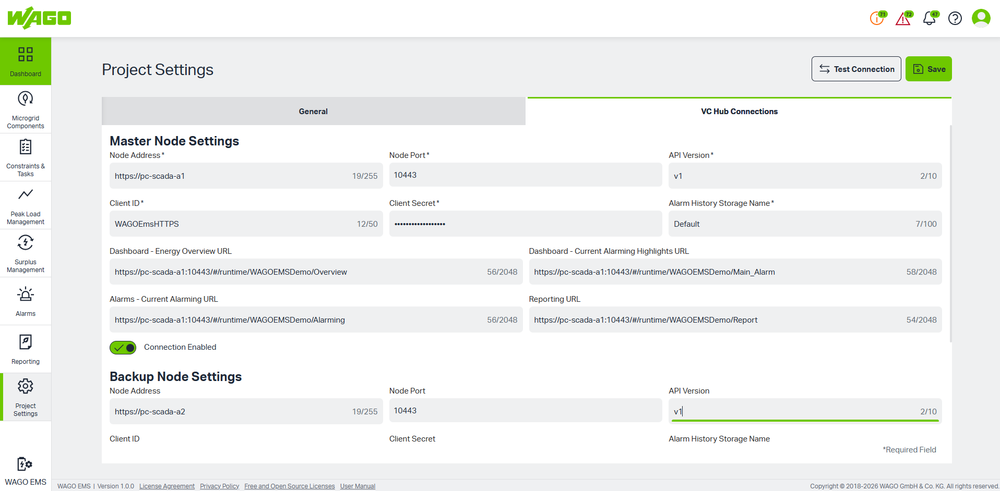
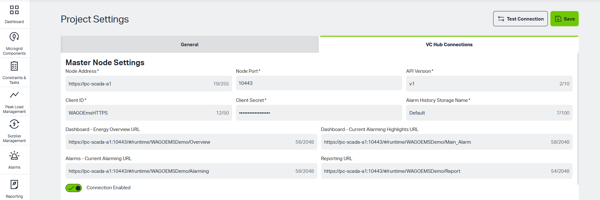
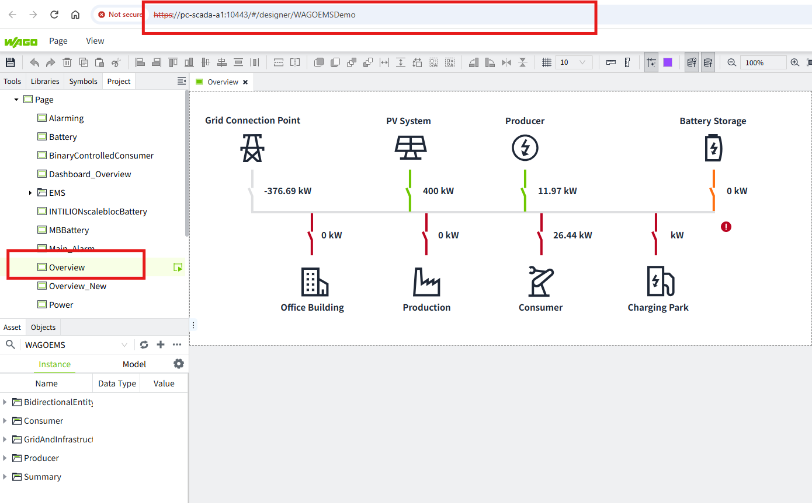

# Configuration
## VC Hub side:
## 1. Create a Client Id to use VC Hub as its identity provider to authenticate its end user.
In **Security → OIDC Server (Open API)**, register `WAGOEMSKeyCloak` with the **Authorization Code Flow** grant type for user sign-in and sign-out.

For more details, users can refer to [OIDC Server](../../management-platform/Security/open-api.md) for the VcHub interface configuration

## 2. Create a Client Id to use VC Hub Connections by making Open API requests from its backend.
In **Security → OIDC Server (Open API)**, register `WAGOEMSHTTPS` with the **Client Credentials Flow** grant type for backend Open API requests.

For more details, users can refer to [OIDC Server](../../management-platform/Security/open-api.md) for the VcHub interface configuration

## 3. Create a Role
Click Security >> Role

For more details, users can refer to [Create Roles](../../management-platform/Security/roles-and-users.md) for the VcHub interface configuration

## 4. Create a user
Click Security >> User

For more details, users can refer to [Create Users](../../management-platform/Security/roles-and-users.md) for the VcHub interface configuration

## 5. Create a Project
Click Projects >> Project

For more details, users can refer to [Create Projects](../../management-platform/projects/index.md) for the VcHub interface configuration

## 6. Design different pages
Click Projects >> Project >> Design >> New Page

For more details, users can refer to [Create Pages](../../2d-visualization/page/index.md) for the VcHub interface configuration

## WAGO EMS Side:
## 1. Configure page on WAGO EMS
After logging into WAGO EMS system, Click left navigation siderbar Project Settings >> VC Hub Connections tab

### 1.1 Master Node Settings

This area is used to configure the primary communication node for the system.

Node Address*: Enter VC Hub server address.

Node Port*: Enter VC Hub communication port number, default value 10443.

API Version*: Enter the API version number, default value v1. 

Client ID*: Enter the backend client ID registered in VC Hub (`WAGOEMSHTTPS` in this guide).

Client Secret*: The password used for authentication, enter Secret which created on VC Hub.

Alarm History Storage Name*: Specify the name of the storage repository for alarm data, default value Default. 

Dashboard - Energy Overview URL: Direct access link for the Dashboard >> Energy Overview page. 

Dashboard - Current Alarming Highlights URL: Link for the Dashboard >> Current Alarms page. 

Alarms - Current Alarming URL: Link for the Alams page. 

Reporting URL: Link for the Reporting page. 

Connection Enabled: Toggle switch. Green indicates Enabled (On), while gray indicates Disabled (Off).

Users can copy the url from VC Hub, replace "designer" to "runtime", append "/" Page name

### 2.2 Backup Node Settings

